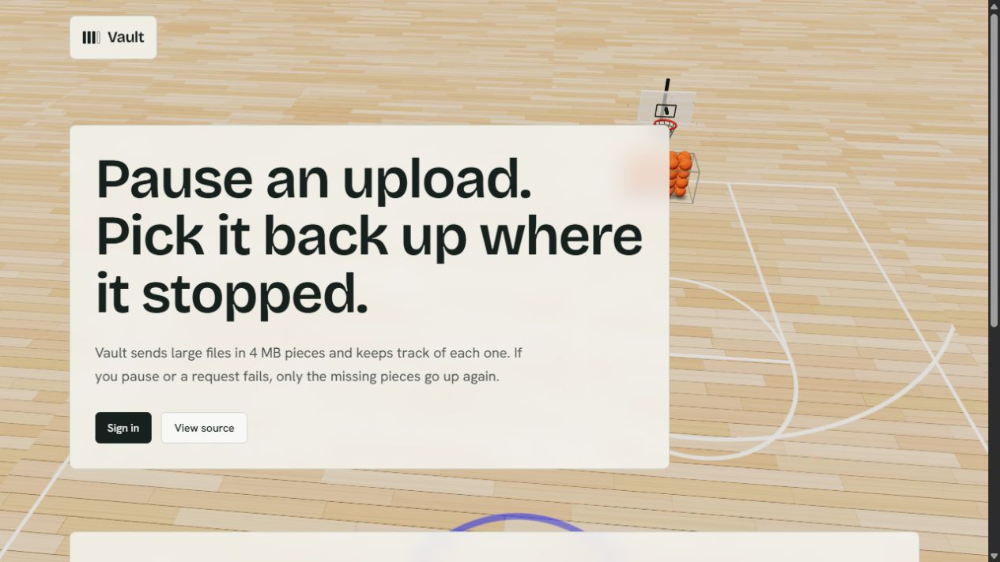
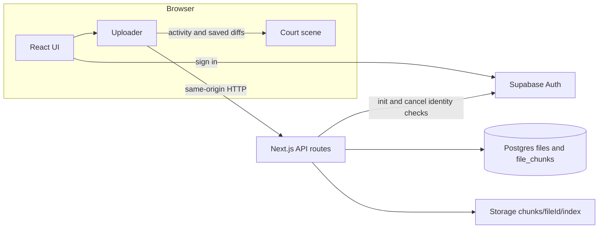
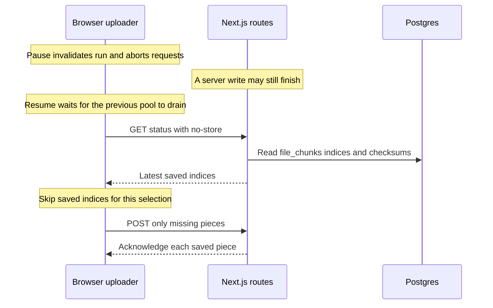
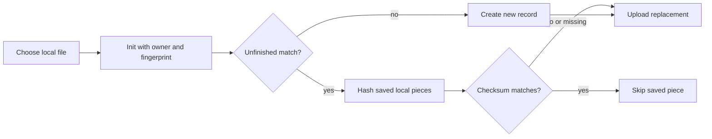
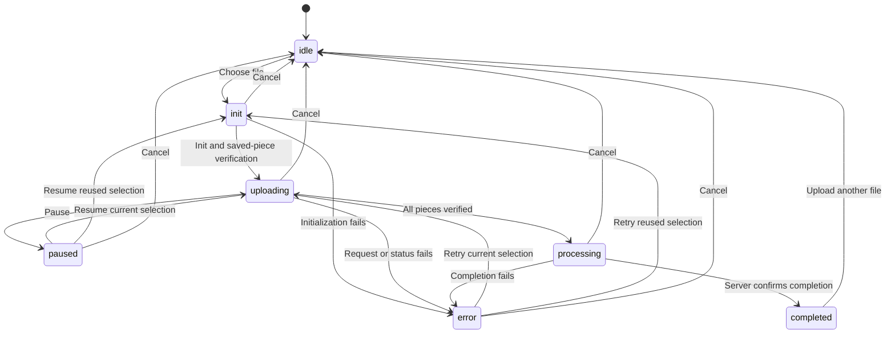
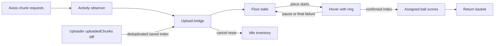
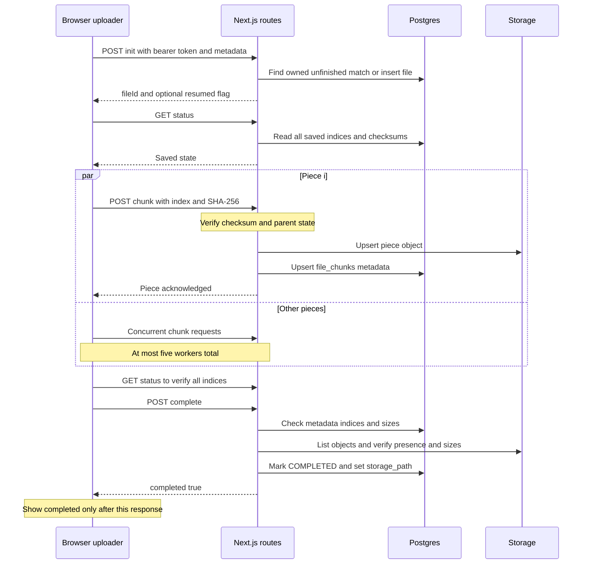
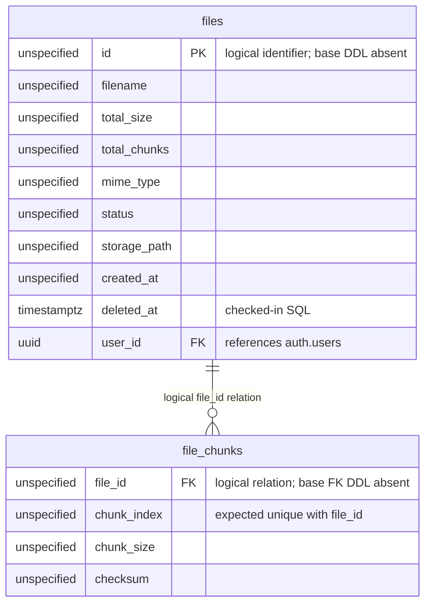

# Vault

Resumable file uploads with verified pieces, streamed downloads and a live basketball court.

  

## Table of contents

| Guide | Reference |
| --- | --- |
| [Overview](#overview) | [Usage guide](#usage-guide) |
| [Demo and screenshots](#demo-and-screenshots) | [Scripts](#scripts) |
| [Features](#features) | [Testing](#testing) |
| [Architecture](#architecture) | [Design decisions and trade-offs](#design-decisions-and-trade-offs) |
| [Tech stack](#tech-stack) | [Security notes](#security-notes) |
| [Project structure](#project-structure) | [Troubleshooting](#troubleshooting) |
| [How an upload works](#how-an-upload-works) | [Limitations and roadmap](#limitations-and-roadmap) |
| [API reference](#api-reference) | [Deployment notes](#deployment-notes) |
| [Database](#database) | [Acknowledgements and credits](#acknowledgements-and-credits) |
| [Getting started](#getting-started) | [License](#license) |
| [Environment variables](#environment-variables) |  |

## Overview

A failed single-request upload can force someone to start again. Vault records independently saved pieces so retry/resume can send only missing work.

1. Slice the local file into 4 MiB pieces (the UI calls them 4 MB).
2. Upload with a five-worker parallel pool and bounded retries.
3. Verify each piece's SHA-256 on the server before recording it.
4. Persist saved indices/checksums in Supabase Postgres and bytes in Storage.
5. Resume from fresh server state; after reload, reselect and verify matching pieces.

This is one Next.js app with Supabase services, not the microservices system described in early Git history. **Evaluation gaps:** the base-table creation SQL is missing, and API authorization is incomplete. See [Database](#database) and [Security notes](#security-notes).

## Demo and screenshots

The landing page contains a labelled, isolated demonstration; it does not upload a real file. This screenshot was captured from the actual local app:



| Needed capture | Status |
| --- | --- |
| Upload in progress, court and compact dock | TODO: add screenshot after signing in |
| Paused upload, no hovering balls | TODO: add screenshot after signing in |
| My files, completed list and usage | TODO: add screenshot after signing in |
| Bin, restore and permanent-delete controls | TODO: add screenshot after signing in |

<details><summary>Pending screenshot Markdown and capture instructions</summary>

Templates only; these four images do not yet exist. Do not substitute a simulated review page for a real upload capture. See [media checklist](docs/media/README.md).

</details>

## Features

| Area | Implemented behavior |
| --- | --- |
| Upload engine | Chunking, five workers, byte progress, pause/resume, retry, serialized run tokens and checksum-verified reselection after reload |
| Integrity | Client/server SHA-256 per piece; completion checks indices, object presence and byte sizes |
| Files | Completed-file list, numeric-order streaming download, Bin, restore, permanent delete and completed-only usage totals |
| Auth | Supabase email sign-up/sign-in and optional Google OAuth; verified owner scoping for init/reuse/cancel only |
| UI | Full-viewport court, actual-request hover balls, confirmed scoring, compact/minimized dock, recent-files drawer, expanding icon rail, mobile drawer |
| Accessibility/resilience | DOM status/controls, reduced-motion and no-WebGL fallbacks, hidden-tab reconciliation, renderer cleanup |

Usage is informational, not an enforced per-user quota. Bin wording mentions five days, but no automatic purge is installed by this repo.

## Architecture



Browser uploads pass through Next.js to Supabase metadata and Storage; only the indicated operations validate identity.

<details><summary>Pause/resume, reload, state machine, downloads and court mapping</summary>



Resume drains the prior run, fetches fresh saved indices and sends only missing pieces.



After reload the user reselects a File, and reused saved pieces are trusted only after local checksum comparison.



Client state waits for explicit completion; Retry needs a retained ID, while Cancel returns to idle.

[Download sequence diagram](docs/architecture.md#download-flow)

Chunk-backed downloads read numeric piece order on demand; legacy merged records use a signed redirect.



Transport activity borrows balls, but deduplicated saved-index events alone authorize scoring.

</details>

All diagrams and their longer explanations are in [docs/architecture.md](docs/architecture.md).

## Tech stack

Versions/ranges are from [package.json](package.json); caret ranges are not resolved versions.
| Technology | Declared version | Role |
| --- | --- | --- |
| Next.js | 15.5.22 | App Router UI, route handlers, server streaming |
| React / React DOM | 19.1.0 | Components, state and effects |
| TypeScript | ^5 | Strict typing and source parser used by tests/lint |
| Supabase JS | ^2.49.1 | Auth, Postgres and Storage clients |
| Axios | ^1.19.0 | Multipart uploads, byte-progress events, cancellation |
| Three.js / types | ^0.186.1 / ^0.186.0 | Lazy-loaded WebGL court |
| Tailwind CSS / PostCSS plugin | ^4.1.4 | Tokens and utility styles |
| Lucide React | ^0.475.0 | Icons |
| Framer Motion / clsx | ^13.0.0 / ^2.1.1 | Declared dependencies; no current src imports found |

## Project structure

```text
.
├── src/
│   ├── app/                 # Landing, login, dashboard and api/upload routes
│   ├── components/          # FileUploader, FileDashboard, court, dock and navigation
│   └── lib/
│       ├── upload.ts        # File slicing, hashing, retry pool and run lifecycle
│       ├── uploadActivity.ts # Visual-only transport observer and timing
│       ├── chunkStorage.ts  # Completion verification; chunkCleanup.ts deletes data
│       ├── uploadAuth.ts    # User validation and cleanup operator secret
│       ├── supabase*.ts     # Separate server and browser clients
│       └── court/           # Physics, shots, textures, bridge and Three.js scene
├── supabase/                # Two schema extensions; base-table DDL absent
├── tests/                   # Isolated storage/client/court regressions and fixtures
├── scripts/                 # Custom lint and opt-in live integration verifier
├── docs/                    # Architecture, API, database, media and verification
├── .env.example             # Public/server configuration placeholders
└── package.json             # Scripts, dependencies and Node engine declaration
```

`src/middleware.ts` is pass-through; `/dashboard/bin` is a legacy redirect to `/dashboard`, not the current Bin view. Older `courtScene.ts` and `BinView.tsx` remain, but current routes use the Three.js court and FileDashboard.

## How an upload works

1. Choose/drop a File; init validates the session and creates/reuses an owned unfinished fingerprint.
2. Fetch uncached status; on reuse hash saved local slices and keep only checksum matches.
3. Hash each missing piece and POST multipart `chunk` with index, checksum and `deferCompletion=1`.
4. The API verifies bytes, upserts Storage and piece metadata, and acknowledges the saved piece.
5. Byte-progress events update sent percent; saved-index diffs update counts and score assigned balls.
6. After the pool, verify status again, then call complete to check all metadata/objects and mark COMPLETED.
7. Show completed only when the explicit response contains `completed: true`.

| Constant in [upload.ts](src/lib/upload.ts) | Value |
| --- | --- |
| CHUNK_SIZE | 4 × 1024 × 1024 = 4,194,304 bytes |
| MAX_CONCURRENT_UPLOADS | 5 workers |
| MAX_CHUNK_RETRIES | 3 **total attempts**, not three extra retries |
| CHUNK_TIMEOUT_MS | 180,000 ms per Axios chunk/complete request |
| Retry delay formula | 1,000 × 2^(attempt − 1): 1 s then 2 s |

The init/status fetches do not set that Axios timeout. Zero-byte files are rejected by init.



The server saves pieces independently and finalizes metadata without assembling a second full object.

## API reference

`{id}` is a file ID. **None** means the handler has no auth/owner check; a client-side sign-in redirect does not protect it. [Full contracts and request/JSON examples](docs/api.md).

| Method | Path | Purpose | Query/body | Success | Explicit error statuses | Auth |
| --- | --- | --- | --- | --- | --- | --- |
| POST | /api/upload/init | Create or reuse owned unfinished record | JSON filename, totalSize, totalChunks, mimeType | 201 `{fileId}` new; 200 `{fileId,resumed:true}` reused | 400, 401, 500 | User + owner |
| GET | /api/upload/{id}/status | Fresh saved-piece metadata | None | 200 `{status,totalChunks,uploadedChunks,checksums}` | 404, 500 | None |
| POST | /api/upload/{id}/chunk | Verify/store one piece | chunkIndex, checksum, optional deferCompletion=1; multipart chunk | 201 `{ok,chunkIndex,uploadedChunks,totalChunks,completed,storagePath}`; 200 if already completed | 400, 404, 409, 500 | None |
| POST | /api/upload/{id}/complete | Verify all pieces and finalize metadata | No body required | 200 `{ok,completed,uploadedChunks,totalChunks,storagePath}` | 404, 409, 500 | None |
| DELETE | /api/upload/{id} | Discard owner's unfinished upload | None | 200 `{ok:true}` | 401, 404, 409, 500 | User + owner |
| POST | /api/upload/cleanup | Discard aged unfinished uploads | hours defaults 24; 0 means all unfinished | 200 `{ok:true,removed}` | 400, 401, 500 | Operator |
| GET | /api/upload/files/list | List completed active/Bin files | bin=1 selects Bin | 200 array of file rows | 500 | None |
| GET | /api/upload/files/{id}/download | Stream pieces or redirect legacy download | None | 200 byte stream; 307 signed URL redirect | 400, 404, 409, 500 before streaming | None |
| DELETE | /api/upload/files/{id} | Move to Bin or permanently delete | permanent=true deletes objects/rows; otherwise soft delete | 200 `{success:true}` | 404 for absent permanent target; 500 | None |
| PATCH | /api/upload/files/{id} | Restore by clearing deleted_at | Body ignored; UI sends action=restore | 200 `{success:true}` | 500 | None |
| GET | /api/upload/usage/quota | Completed non-Bin metadata totals | None | 200 `{usedBytes,fileCount}` | 500 | None |

## Database

[SQL evidence, column contract and reference base-table SQL](docs/database.md). Only two extension migrations are supplied: [Bin](supabase/bin-soft-delete.sql) and [ownership](supabase/upload-ownership.sql). **Base CREATE TABLE migrations, most column types, base keys/defaults and RLS policies are not checked in.** Obtain the original schema or verify the proposed reference SQL against your own Supabase project; these extensions alone cannot bootstrap it.



This logical ER model marks unprovided base types as unspecified; PK/file_id keys describe the code contract, not verified base DDL.

`UPLOADING` is inserted by init; completion writes `COMPLETED`. `FAILED` is recognized for legacy/recoverable attempts but is not written by current failure handlers. `deleted_at = null` means active; setting it moves a completed file to Bin (or claims cancellation). The extension indexes are `files_deleted_at_idx` and the partial `(user_id, created_at DESC)` `files_unfinished_owner_idx`.

## Getting started

**Prerequisites:** Git, npm, a Supabase project and a compatible Node runtime. The app declares Node >=18; installed Next.js declares ^18.18.0, ^19.8.0 or >=20.0.0. These docs were checked with Node 24.22.1/npm 11.19.1.

```powershell
git clone --depth 1 https://github.com/saksham17-tech/dfup.git vault
cd vault
npm install
Copy-Item .env.example .env.local
```

The copy command is for a fresh checkout; do not overwrite an existing configured .env.local.

1. Create/select a Supabase project. Obtain the **missing original base schema** for files/file_chunks or review the [reference SQL against your own project](docs/database.md#reference-sql--verify-against-your-own-supabase-project), then apply bin-soft-delete.sql followed by upload-ownership.sql in the SQL editor. The reference is inferred and untested on live Supabase; this repository has no complete bootstrap migration.
2. Create a Storage bucket named `dfup`, or set SUPABASE_STORAGE_BUCKET. A **private** bucket works with server service-role reads and signed URLs; the code itself does not set/check visibility or provision policies. Permit pieces of 4 MiB plus the relevant host request overhead.
3. Enable email auth. Google is optional: configure its provider credentials/callback in the Supabase console and allow the app redirect `http://localhost:3000/dashboard`; the code sends `${window.location.origin}/dashboard`. Use the matching production origin later. Provider setup was not exercised in this docs pass.
4. Fill .env.local using the [table below](#environment-variables); never commit secrets. Restart after configuration changes.
5. Start the app, open http://localhost:3000, select Sign in, and create an account or use an existing one. Confirm email if your Supabase project requires it.

```powershell
npm run dev
```

For a production-mode local check, stop dev first (both share .next):

```powershell
npm run build
npm start
```

The landing demo and mocked tests can run without a provisioned live database. Actual sign-in/uploads require configuration and the schema above.

## Environment variables

All application/script environment reads are listed here; [example file](.env.example) contains placeholders only. NEXT_PUBLIC values are browser-visible and included in the built client.

| Name | Required? / scope | Purpose | Example placeholder |
| --- | --- | --- | --- |
| SUPABASE_URL | Server; optional if public URL is set | Server project URL, preferred over fallback | https://YOUR_PROJECT.supabase.co |
| SUPABASE_SERVICE_ROLE_KEY | Server required; **secret** | Privileged DB/Storage client; never browser-expose | your-service-role-key |
| SUPABASE_STORAGE_BUCKET | Server optional | Bucket; defaults to dfup | dfup |
| NEXT_PUBLIC_SUPABASE_URL | Browser required for auth | Browser project URL; server fallback too | https://YOUR_PROJECT.supabase.co |
| NEXT_PUBLIC_SUPABASE_ANON_KEY | Browser required for auth | Public anon key, not service-role key | your-anon-key |
| UPLOAD_CLEANUP_TOKEN | Server required only for cleanup; **secret** | Operator bearer secret, minimum 32 characters | empty until configured |
| UPLOAD_TEST_ACCESS_TOKEN | Local live-test script only; **secret** | Signed-in user's token; script reads process environment, not .env.local automatically | empty until explicitly supplied |

## Usage guide

1. **Sign in**, then use Upload. Choose/drop a file; Preparing includes any saved-piece checksum verification.
2. **Watch the dock:** uploading is activity, saved is acknowledgement, percent is bytes sent. Hovering balls show real requests; only confirmation scores them. Above 40 pieces, balls represent grouped shares.
3. **Pause/Resume** keeps the File/ID while mounted. After reload or leaving Upload, reselect the same local file to find matching saved work; the browser cannot reopen it automatically.
4. **Cancel** stops the run and requests deletion of your unfinished upload. Navigation/Upload another file stops locally without discard. A late completed upload is protected from cancellation.
5. **Download** from My files or Recent files. Downloads stream saved pieces through the API.
6. **Delete** opens a confirmation: Move to bin preserves pieces; Restore returns a Bin entry; Delete permanently removes objects and metadata. No automated five-day purge is installed.

## Scripts

| npm script | Actual command | Purpose |
| --- | --- | --- |
| dev | next dev | Development server, default port 3000 |
| build | next build | Production build and type validation |
| start | next start | Serve a completed production build |
| test | node --test with four explicit test files | Isolated regression suite |
| lint | node scripts/lint.cjs | Custom TypeScript AST rules; **not ESLint** |

## Testing

```powershell
npm test
npm run lint
npx tsc --noEmit
```

| Test file | Coverage |
| --- | --- |
| [upload-client.test.cjs](tests/upload-client.test.cjs) | Serialized pause/resume, stale runs, retry/completion, checksum reuse, cancellation, 104 MiB simulated pool and transport activity |
| [upload-storage.test.cjs](tests/upload-storage.test.cjs) | Route/helper contracts, pagination, missing objects, streaming order/cancel, owner checks, init, quota and cleanup |
| [court.test.cjs](tests/court.test.cjs) | Physics, saved-event deduplication, grouped inventory, assigned shots, dock markup and reduced-motion/static fallback |
| [court-lifecycle.test.cjs](tests/court-lifecycle.test.cjs) | Real Three.js scene with fake GPU adapter, hidden/off-screen state, hover/return counts, context loss and disposal |

These tests use HTTP/DB/Storage mocks and never prove a live Supabase deployment. Auth-provider flows, a real browser large-file upload and physical mobile/GPU coverage are not automated here. The [opt-in live verifier](scripts/verify-court-live.cjs) requires an access token and a server on port 3001; its invocation and unrun live prerequisites are documented in [verification notes](docs/verification.md).

## Design decisions and trade-offs

| Decision | Benefit and cost |
| --- | --- |
| 4 MiB pieces | Code comment targets a 4.5 MB request-body budget; multipart overhead and actual host limits still matter. |
| Capped parallelism | Five workers overlap requests without unbounded in-flight work; no adaptive network tuning. |
| SHA-256 per piece | Detects transfer/reselection mismatches; not antivirus, authentication or whole-file deduplication. |
| Database saved state | Resume survives losing a browser request/selection; depends on consistent DB/object state. |
| Keep pieces, stream on download | Avoids a second whole-file Storage object, merge-time size limits and full-file RAM; costs sequential object reads per download. |
| API proxy | Keeps service-role credentials server-side and verifies received bytes; every upload/download byte traverses the host. |
| Soft delete | Offers restore without moving bytes; still occupies real Storage until permanent deletion. |

## Security notes

Authentication enforced: `POST /api/upload/init` validates user identity and scopes reuse/new ownership; `DELETE /api/upload/{id}` validates identity and the unfinished upload's owner. `POST /api/upload/cleanup` requires an operator secret, not a user session. Other protections include server-only service-role keys, received-piece hashes and safe download filename/header handling.

**No authentication or ownership checks:** `GET /api/upload/{id}/status`, `POST /api/upload/{id}/chunk`, `POST /api/upload/{id}/complete`, `GET /api/upload/files/list`, `GET /api/upload/files/{id}/download`, `DELETE /api/upload/files/{id}` (soft and permanent), `PATCH /api/upload/files/{id}` (restore), and `GET /api/upload/usage/quota`. Middleware is pass-through; the privileged server client bypasses RLS. This is not a production-ready multi-tenant security boundary.

There is no application rate limiting, malware scanning, enforced per-user storage cap or complete MIME/content validation. Quota is not physical Storage accounting. The legacy MAX_STORAGE_LIMIT_BYTES constant is not enforced. Review these gaps before exposing the service publicly.

## Troubleshooting

| Symptom | What to check/do |
| --- | --- |
| Resume appears to restart | Check same File/ID while mounted, fresh status reading file_chunks, and ownership/fingerprint/checksums after reselection; changed names, MIME or completed/Bin rows do not reuse. |
| 100% sent but not completed | Bytes sent is not saved; inspect chunk responses and explicit complete errors. Intact FAILED records can finalize; missing/damaged objects need replacement/re-upload. The old merge path is no longer used. |
| Space used but no listed files | Current quota excludes unfinished/FAILED/Bin rows. Refresh and verify deployed route versions. Global/non-paginated list/quota queries can be limited by server row caps. |
| Supabase rejects a piece | Inspect Storage errors, bucket size/type policy and host body/timeout limits; the code does not configure provider limits. |
| crypto.subtle unavailable | Use localhost or a secure browser context; the uploader calls Web Crypto directly. |
| Missing public/server config | Populate the corresponding environment variables and restart/rebuild; login checks public variables, routes require service-role access. |
| Address already in use | Stop the process occupying port 3000 or use Next's port option; align auth redirect origin with the selected port. |
| Build cannot find .next files | Stop dev before build/start; concurrent dev/build processes share generated output. |
| Bin says automatic five-day deletion | UI wording overstates the implementation. No scheduler/purge is installed. |
| Abandoned rows/objects | Use protected cleanup and audit orphan object names as described in [operator cleanup](docs/api.md#operator-cleanup); never delete all chunks/. |

## Limitations and roadmap

Authorization limit: only `POST /api/upload/init` and `DELETE /api/upload/{id}` enforce user identity/ownership; `POST /api/upload/cleanup` uses an operator secret. **Unprotected:** `GET /api/upload/{id}/status`, `POST /api/upload/{id}/chunk`, `POST /api/upload/{id}/complete`, `GET /api/upload/files/list`, `GET /api/upload/files/{id}/download`, `DELETE /api/upload/files/{id}`, `PATCH /api/upload/files/{id}` and `GET /api/upload/usage/quota`. Other limits: every byte traverses the server; no Range/parallel download reads, whole-file hash, direct-to-Storage upload, concurrent fingerprint claim or base-schema migration. Init/status have no explicit timeout. List/quota are global and not handler-paginated. Cleanup is manual, creation-age based and nontransactional; cancel discard is fire-and-forget. No automatic Bin purge or enforced storage cap exists.

Future work, **not shipped**: complete schema/RLS migrations and owner authorization for all routes; rate limits/enforced quotas; direct-to-Storage resumable transfer; scheduled cleanup/Bin purge; Range downloads; whole-file verification; live browser/auth end-to-end coverage.

## Deployment notes

Use a host supporting Next.js route handlers, Node crypto/Buffer and streamed responses. Configure separate public and secret environment values, DB schema, private-bucket access and auth redirect origins. Build-time Google fonts may need network access or a populated cache. Verify the host's actual request-body, execution-duration and streaming limits and the Supabase bucket/project limits; no deployment configuration or plan capacity is guaranteed by next.config.mjs. The client timeout cannot override a shorter host limit. Fix the API authorization gaps before public multi-user deployment.

## Acknowledgements and credits

The configured Git remote is [saksham17-tech/dfup](https://github.com/saksham17-tech/dfup). The landing page's hard-coded View source link instead targets [xsanchitgupta/distributed_file_upload_system](https://github.com/xsanchitgupta/distributed_file_upload_system); it is preserved as found, not claimed as verified upstream attribution. Git history contains an earlier NexusDrive/microservices README, but does not establish a template/upstream license. Confirm provenance with the maintainer. Next.js/React, Supabase, Axios, Three.js, Tailwind and Lucide provide the current platform/libraries; Bricolage Grotesque and Hanken Grotesk are loaded through next/font/google.

## License

No LICENSE file or package license field is present. No license grant is inferred or added here.

Documentation checks, remaining screenshots and unresolved setup/provenance limits: [docs/verification.md](docs/verification.md).
