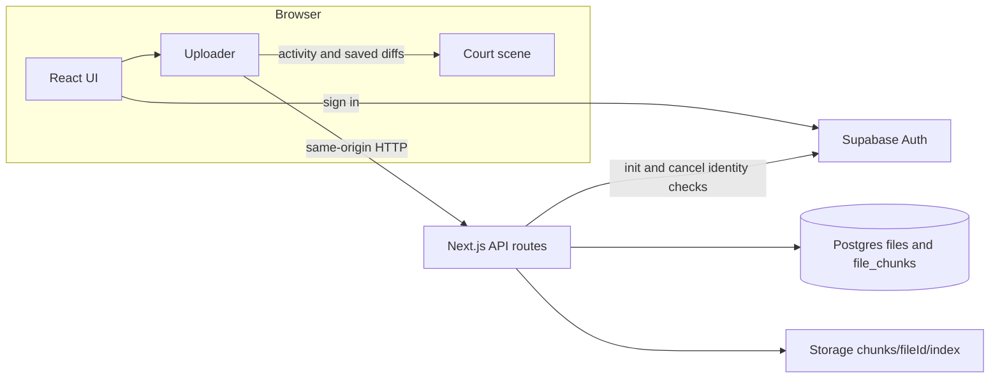
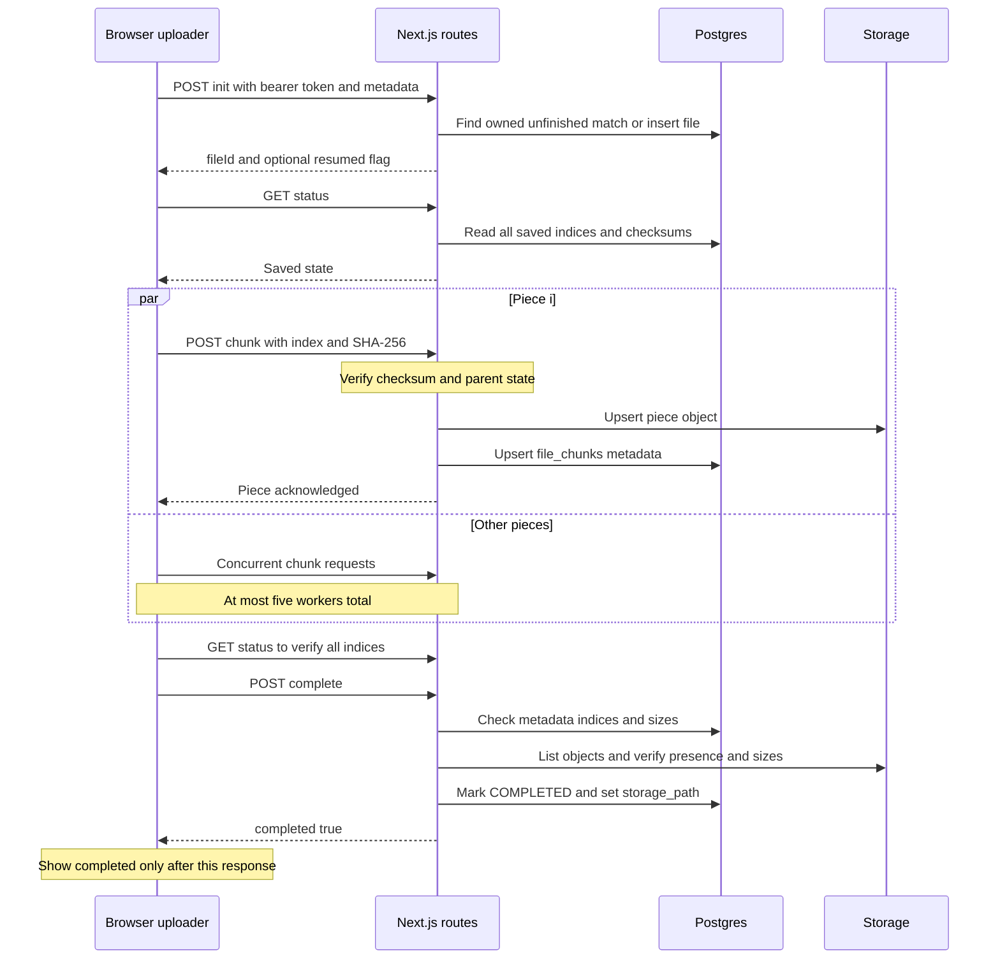
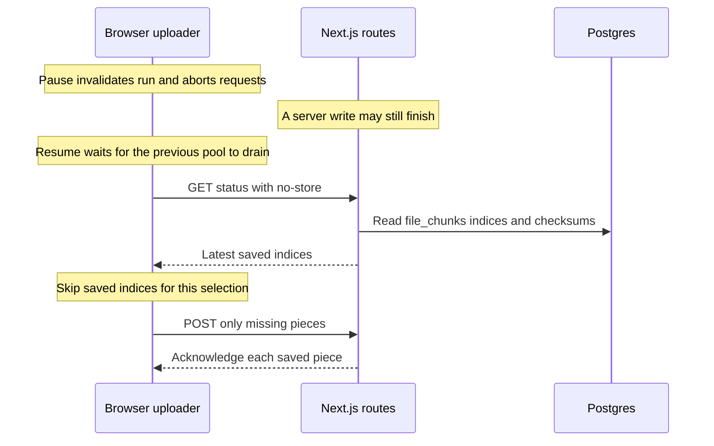
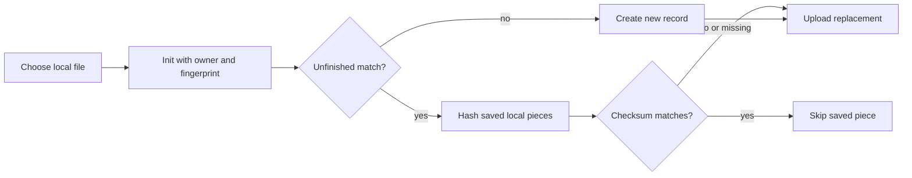
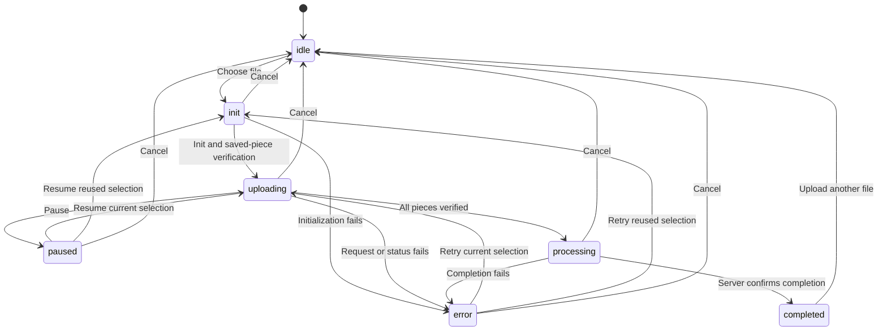
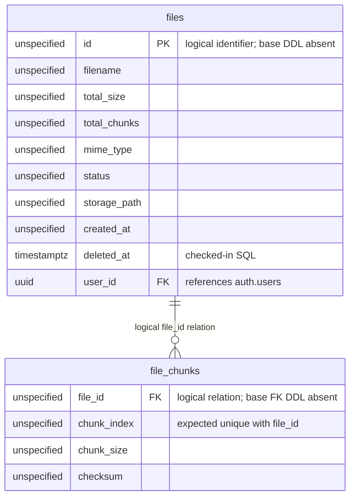
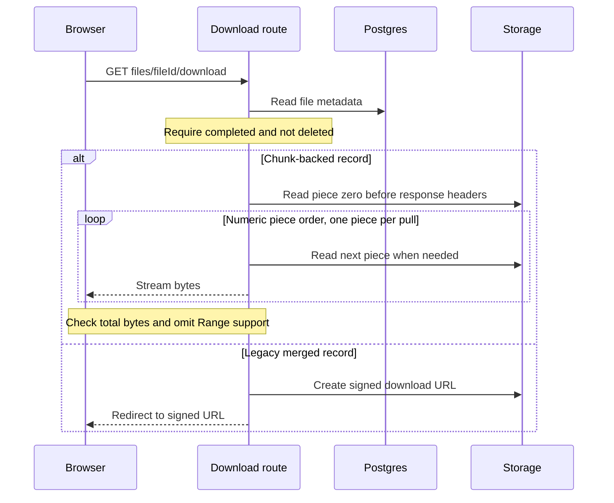
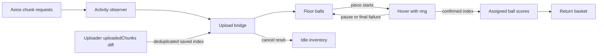

# Architecture

[Back to README](../README.md)

These diagrams describe the checked-in Next.js/Supabase implementation. The old
microservices architecture in early Git history is not part of the current app.
The API auth boundary is incomplete; see [API reference](api.md#authentication).

## System architecture

The browser uploads through Next.js, which stores metadata in Postgres and piece objects in Supabase Storage.

Supabase browser sessions are persisted/refreshed by the browser SDK. Only init and
unfinished-upload cancellation validate the user's bearer token in their route
handlers. Cleanup validates a separate operator secret. The other upload/file
handlers use the server service-role client without an auth/owner check.
`src/middleware.ts` currently passes requests through.

## Upload sequence

Each chunk is checked and saved independently; the current client defers finalization until its explicit complete request.

Chunk workers hash locally with Web Crypto, upload multipart bodies through Axios,
and retry up to three total attempts. Client requests send `deferCompletion=1` so
old saved metadata cannot complete a reused file before mismatched pieces have
been replaced. Legacy requests without that flag can trigger the same completion
helper inside the chunk route. A late request for an already completed file gets
success after normal input/checksum validation, without rewriting Storage.

Completion is metadata finalization, not assembly of a new object. It paginates
piece metadata and Storage listings, verifies all indices and aggregate sizes,
and records `chunks/<fileId>` as the download source. It does not re-hash stored
objects or compute a whole-file hash at completion.

## Pause and resume

Resume uses fresh server state after the previous run drains, so an accepted request with a lost response is not blindly resent.

The File and ID live in the uploader closure while it is mounted. `abort(false)`
on navigation/unmount stops local work but retains pieces on the server. A fresh
page needs the user to choose the local file again; it cannot silently reopen the
browser's previous File object.

### Choose the same file after reload

Reselection reuses the newest matching owned unfinished record and skips only pieces whose local checksums match the status response.

The fingerprint is filename, total size, total piece count and MIME type, plus the
verified owner. It is a lookup hint, not a content hash. Completed and Bin records
are excluded. The current lookup/insert is not a transaction or unique-fingerprint
claim; concurrent initializations/writers are a remaining limitation.

## Upload state machine

The normal UI flow distinguishes bytes sent from saved pieces and waits in processing for explicit server completion.

Retry is offered only when an upload ID is retained. `processing` is a client
state; the court additionally uses `finishing` while all bytes are sent or the
completion request is pending. Those are not Postgres statuses. Browser errors do
not themselves write the database status `FAILED`.

## Database ER diagram

This is the schema contract used by the code, with unknown base-column types explicitly marked unspecified.

`PK`/the `file_id` relation in this diagram express the logical keys required by
lookups, not independently verified base-table constraints. Only `user_id`'s
foreign key and the two extension indexes are defined in the supplied SQL.
See [database reference](database.md) for the exact evidence and fresh-setup gap.

## Download flow

Chunk-backed downloads stream numeric piece order without building a whole-file buffer; legacy merged records use a signed redirect.

The first read happens before headers, allowing an HTTP error for a missing first
piece. Later failures error the response stream after a 200 has begun. Cancelling
a download propagates an abort signal and stops subsequent reads. Content-Length,
Content-Disposition, private no-store, nosniff and Accept-Ranges: none are set on
chunk-backed responses. The route verifies byte totals, not a whole-file digest.

## Court mapping

The scene borrows floor balls for real request activity, but only saved-index events authorize scoring.

The inventory is capped at 40 balls; confirmed visual shares are
`floor(savedPieces * min(totalPieces,40) / totalPieces)`. Above 40 pieces, a partial
share returns its borrowed ball instead of creating a shot. Floor, hovering and
confirmed shares stay conserved; confirmed includes queued shots, arcs and the
basket pile. Idle uses 24 balls; Files/Bin use ten calm balls. The landing demo has
its own explicitly separate bridge and does not upload data.

Retries retain a hover until the final attempt fails. Pause releases unsaved
hovers while confirmed arcs can finish. Hidden/off-screen scenes stop drawing;
return reconciles confirmed work without a long replay. Reduced motion, scene
errors and unavailable WebGL leave DOM status/controls and static fallback
progress usable. `src/lib/courtScene.ts` is an older 2D implementation; the current
CourtCanvas imports the Three.js implementation in `src/lib/court/scene.ts`.
